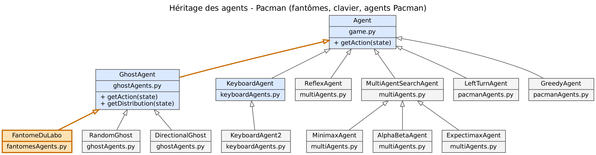
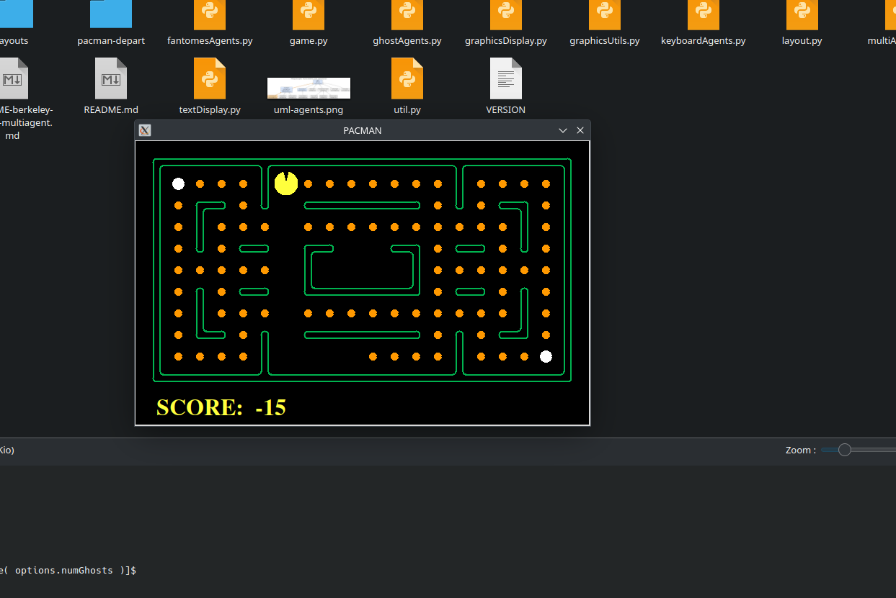
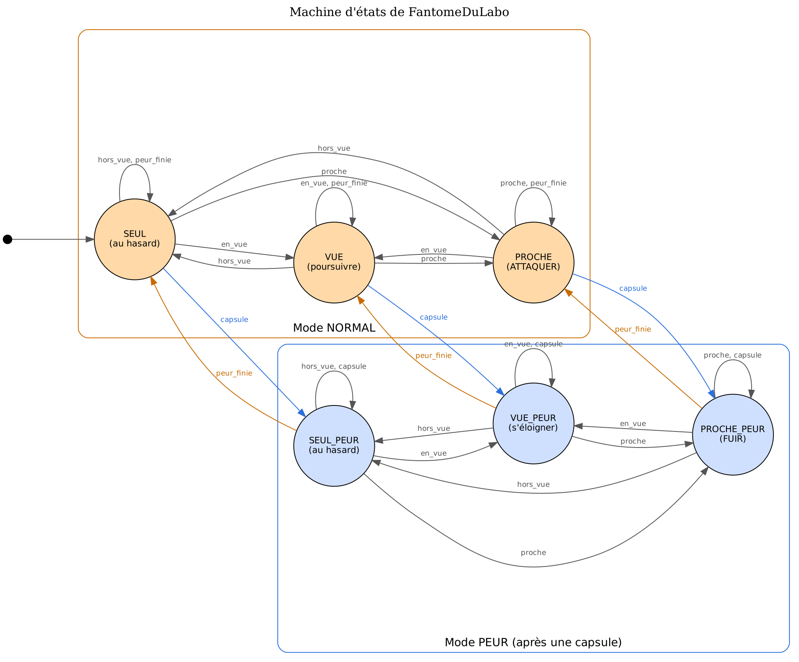
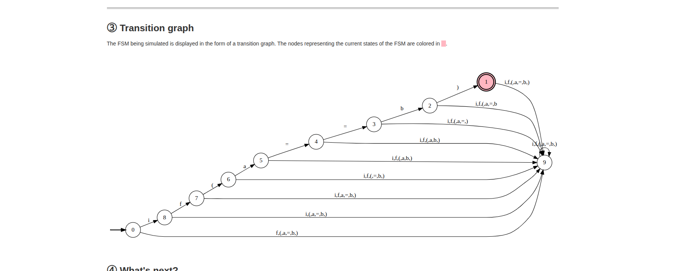
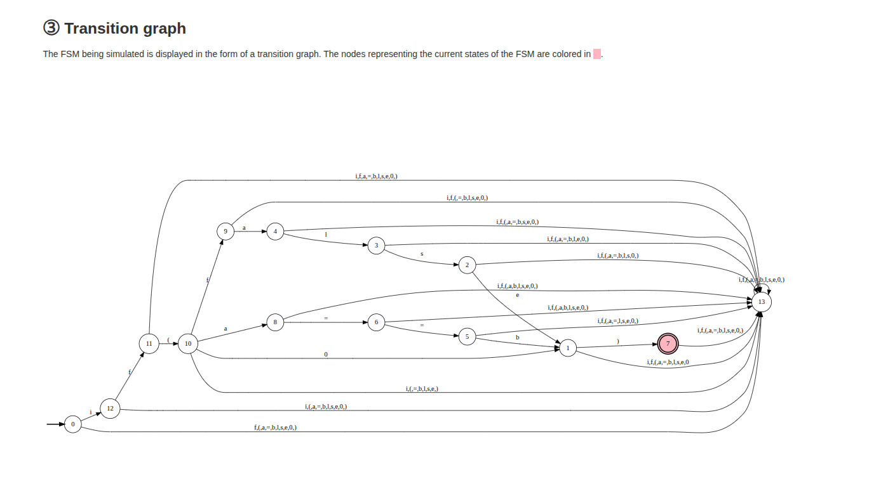
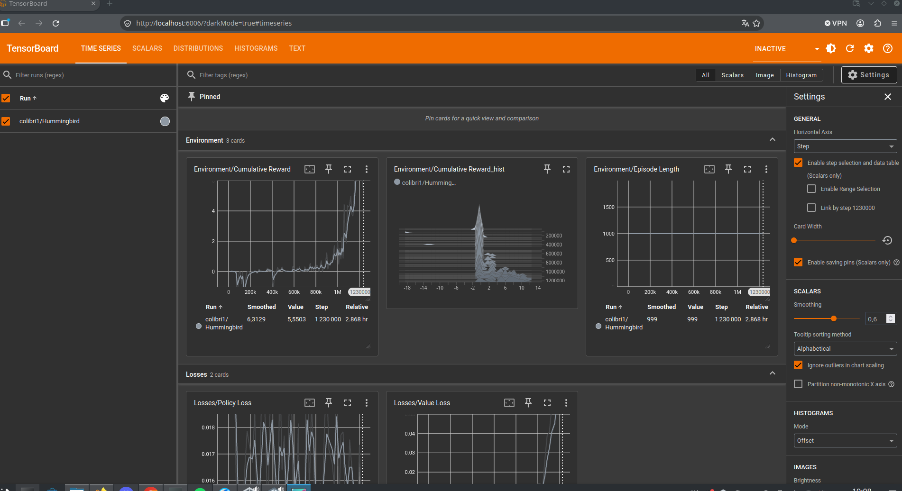
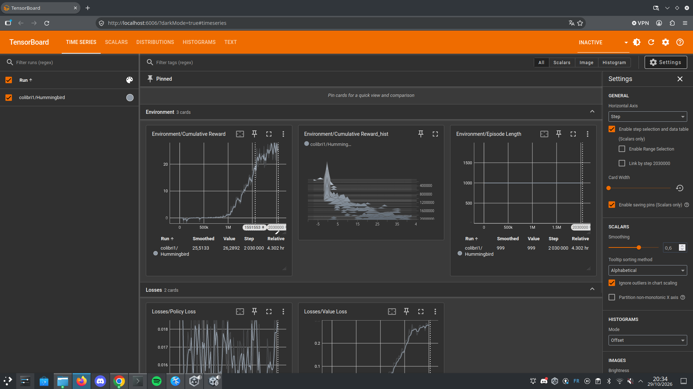

# 🤖 Laboratoires Agents - L'évolution de l'agent

> **Énoncé complet** : https://intelligence.projet.autos/labo-agents/  
> **Remise : 7 jours après chaque labo** (dates dans le calendrier des rencontres)  
> **Total du module : 10 %** = série noire 3 % + série rouge 4 % + série violette 3 %

| Série | L'agent | Points | Règle |
|---|---|---|---|
| ⬛ Noire | déterministe | 3 % | les 2 labos obligatoires |
| 🟥 Rouge | entraîné | 4 % | 1 labo au choix |
| 🟪 Violette | cognitif | 3 % | obligatoire |

---

## ⬛ SÉRIE NOIRE - L'agent déterministe (3 %, les deux labos obligatoires)

### 🎛️ LABO MACHINES D'ÉTATS (1 %)

#### Partie 1 : Superhéros narcoleptique - Machine d'états avec `transitions`
**Template** : https://github.com/pytransitions/transitions#quickstart  
📁 **Mon notebook Colab** : [Mon notebook Colab](https://colab.research.google.com/drive/1BHi6hUYsvmbqSO0sSnVNY6PBpZ8fhZBP?usp=sharing)

#### Partie 2 : Les états FAIM / BIEN / PEUR - Machine d'états comportementale
**Matrice état-transition** : voir la diapo du cours  
📁 **Mon notebook Colab (avec la librairie, puis avec ma propre classe)** : [Mon notebook Colab](https://colab.research.google.com/drive/1BHi6hUYsvmbqSO0sSnVNY6PBpZ8fhZBP?usp=sharing)

📑 **Mes réponses aux questions :**

- **Listez les états ?** FAIM, BIEN, PEUR
- **Listez les événements ?** ennemi arrive, ennemi quitte, ami arrive, recevoir nourriture
- **Quel événement pourrait-on ajouter ?** « temps passe » : avec le temps, la nourriture se digère et l'agent BIEN redevient FAIM ; dans les états FAIM et PEUR, rien ne change. Je l'ai ajouté en bonus à ma propre classe (`ajouter_transition('temps_passe', 'BIEN', 'FAIM')`), ce qui ajoute une colonne à la matrice état-transition.

---

### 👻 LABO PACMAN (2 %)

**Code de départ** : https://intelligence.projet.autos/labo-agents/pacman-depart.zip (le Pacman de Berkeley, `pac3man`, corrigé pour Python 3)  

#### Partie 1 : Reverse engineering du code
   📁 **Diagramme UML de l'héritage des agents** :

   

📑 **La responsabilité de chaque classe :**
```
Agent (game.py)          : classe de base de tout personnage. Elle impose une seule méthode,
                           getAction(state), qui reçoit l'état du jeu et retourne une direction
                           (North, South, East, West ou Stop).
GhostAgent (ghostAgents.py) : classe de base des fantômes. Son getAction() tire une direction au
                           hasard selon la distribution de probabilités que chaque sous-classe
                           définit dans getDistribution() (RandomGhost : uniforme ; DirectionalGhost :
                           favorise la poursuite ou la fuite).
KeyboardAgent (keyboardAgents.py) : agent piloté par le joueur. Il lit les touches (WASD ou
                           flèches), garde la dernière direction si aucune touche n'est pressée et
                           choisit une direction légale au hasard si la touche demandée est bloquée.
GameState (pacman.py)    : la photo complète du jeu à un instant donné : nourriture, capsules,
                           positions et minuteries des agents, score. Les agents l'interrogent
                           (getLegalActions, getPacmanPosition...) et generateSuccessor() produit
                           l'état suivant après une action.
GhostRules (pacman.py)   : les règles qui s'appliquent aux fantômes : mouvements permis (pas
                           d'arrêt, pas de demi-tour sauf cul-de-sac), vitesse réduite de moitié
                           quand ils ont peur, décompte de la minuterie de peur, et collisions
                           avec Pacman (Pacman meurt, ou le fantôme est mangé et retourne au départ).
Game (game.py)           : le chef d'orchestre. Sa boucle run() demande une action à chaque agent
                           à tour de rôle, calcule le nouvel état, met à jour l'affichage et
                           demande aux règles si la partie est gagnée ou perdue.
```

📑 **La machine d'état qui existe déjà :**
- **Les états ?**
  - **NORMAL (chasseur)** : `scaredTimer == 0`. Le fantôme va à vitesse 1, il tue Pacman au contact,
    et DirectionalGhost se rapproche de Pacman (distance minimale, 80 %).
  - **EFFRAYÉ** : `scaredTimer > 0`. Le fantôme va à vitesse 0,5 (bleu à l'écran), Pacman peut le
    manger, et DirectionalGhost s'éloigne de Pacman (distance maximale, 80 %).
- **Les événements ?**
  - *Pacman mange une capsule* : NORMAL ou EFFRAYÉ → EFFRAYÉ (`scaredTimer = SCARED_TIME = 40`, pour tous les fantômes).
  - *Le temps passe* (chaque mouvement du fantôme) : EFFRAYÉ → EFFRAYÉ tant que la minuterie dépasse 0,
    puis EFFRAYÉ → NORMAL quand elle tombe à 0 (`GhostRules.decrementTimer`).
  - *Pacman touche le fantôme EFFRAYÉ* : EFFRAYÉ → NORMAL ; le fantôme retourne à son point de départ,
    sa minuterie est remise à 0 et Pacman gagne 200 points (`GhostRules.collide`).
  - *Pacman touche le fantôme NORMAL* : la partie passe à PERDU (−500 points).

Il existe aussi une petite machine d'états au niveau de la partie : **EN COURS** → **GAGNÉ**
(toute la nourriture mangée, +500) ou **PERDU** (Pacman touché par un fantôme normal),
vérifiée par `ClassicGameRules.process()`.

#### Partie 2 : Mini-modifications réalisées
- [x] Affichage de la grille légèrement modifié : murs verts, nourriture orange et plus grosse (`graphicsDisplay.py`, lignes 29, 68-69)
- [x] Création des fantômes annulée : interrupteur `ANNULER_FANTOMES` dans `readCommand()` (`pacman.py`) ; l'option `-k 0` fait la même chose
  
- [x] Fantômes qui tournent toujours à droite : classe `FantomeDroite` dans `ghostAgents.py`, lancée avec `python3 pacman.py -g FantomeDroite`. Ils suivent les murs comme la règle de la main droite et tournent en rond : 32 cases différentes visitées en 62 déplacements.
- [x] Message en console quand Pacman s'approche : dans `GhostAgent.getAction()`, donc hérité par tous les fantômes. Le message ne s'affiche qu'à l'entrée dans la zone (3 cases), grâce à une mémoire LOIN/PROCHE.
- [x] Chemin parcouru par un fantôme mémorisé : liste `self.chemin` dans `GhostAgent`, remise à zéro dans `registerInitialState()` et résumée dans `final()`, deux méthodes appelées automatiquement par `Game.run()`.
- [x] Ma propre classe de fantôme, avec sa couleur, instanciée dans le jeu : `FantomeDuLabo` (`fantomesAgents.py`), rose fuchsia, lancé avec `python3 pacman.py -g FantomeDuLabo -l smallClassic`. Grâce à l'héritage, il reçoit l'alerte et la mémoire du chemin sans code supplémentaire.

#### Partie 3 : Ma machine d'état comportementale dans le fantôme
**Ma librairie de machine d'états importée (celle du labo Machines d'états)** : [machineEtats.py](pacman/machineEtats.py) 
📁 **Illustration de la machine d'états ou tableau état-transition** :


📑 **Les états de mon fantôme et ce qu'il fait dans chacun :**
```
SEUL         : Pacman loin et hors de vue      -> action au hasard
VUE          : Pacman en ligne de vue          -> le poursuivre (se rapprocher, 80 %)
PROCHE       : Pacman à 3 cases ou moins       -> ATTAQUER (toujours la direction la plus proche)
SEUL_PEUR    : effrayé, Pacman hors de vue     -> action au hasard
VUE_PEUR     : effrayé, Pacman en vue          -> s'éloigner (80 %)
PROCHE_PEUR  : effrayé, Pacman à 3 cases ou moins -> FUIR (toujours la direction la plus loin)

Interprétation de la consigne « PROCHE = FUIR » : elle s'applique au mode « chasse aux fantômes »
(PROCHE_PEUR). En mode normal, un fantôme proche attaque, ce qui est plus logique pour un chasseur.
```

📑 **Matrice état-transition** (✓ = l'état ne change pas) :

| État actuel (action) | pacman_hors_vue | pacman_en_vue | pacman_proche | capsule_mangee | peur_finie |
|---|---|---|---|---|---|
| **SEUL** (au hasard) | ✓ | VUE | PROCHE | SEUL_PEUR | ✓ |
| **VUE** (poursuivre) | SEUL | ✓ | PROCHE | VUE_PEUR | ✓ |
| **PROCHE** (ATTAQUER) | SEUL | VUE | ✓ | PROCHE_PEUR | ✓ |
| **SEUL_PEUR** (au hasard) | ✓ | VUE_PEUR | PROCHE_PEUR | ✓ | SEUL |
| **VUE_PEUR** (s'éloigner) | SEUL_PEUR | ✓ | PROCHE_PEUR | ✓ | VUE |
| **PROCHE_PEUR** (FUIR) | SEUL_PEUR | VUE_PEUR | ✓ | ✓ | PROCHE |

📑 **Résultats** (10 parties contre `GreedyAgent`, `-q -n 10`, plus le score de Pacman est bas, meilleurs sont les fantômes) :

| Fantômes | Score moyen de Pacman | Score médian | Victoires de Pacman |
|---|---|---|---|
| FantomeDuLabo (machine d'états) | 29,8 | −192 | 1/10 |
| RandomGhost | 120,1 | 96 | 1/10 |

📑 **Observations :**
- `SEUL -> PROCHE` sans passer par VUE : la distance de Manhattan traverse les murs, le fantôme « sent » Pacman derrière un mur. Amélioration possible : distance réelle dans le labyrinthe.
- `PROCHE_PEUR -> SEUL` en un pas : le fantôme mangé reçoit `peur_finie` puis `pacman_hors_vue` au même tour.
- Limite : les fantômes ne peuvent pas faire demi-tour (`GhostRules`), un fantôme en fuite avec Pacman derrière lui doit parfois avancer vers lui.

#### Partie 3 : Parsing (FSM)
**Outils** : https://ivanzuzak.info/noam/webapps/fsm_simulator/ (FSM Type : DFA)

📁 **Image de la machine d'états `if(a==b)`** :

Expression régulière : `if\(a==b\)`



Une ligne droite de 10 états : un état par caractère lu (`i`, `f`, `(`, `a`, `=`, `=`, `b`, `)`),
l'état acceptant (double cercle) et l'état puits. À chaque état, un seul caractère fait avancer ;
tous les autres mènent au puits, d'où la machine ne ressort jamais : c'est l'erreur de syntaxe.

📁 **Image de la machine d'états finale (`if(false)`, `if(0)`)** :

Expression régulière : `if\((a==b+false+0)\)`
(`\(` et `\)` sont de vraies parenthèses à lire ; `( )` regroupent l'alternative ; `+` veut dire OU)



14 états, puits compris :

| Partie | États | Rôle |
|---|---|---|
| Début commun | 0 → 12 → 11 → 10 | lit `i`, `f`, `(` |
| Branche `false` | 10 → 9 → 4 → 3 → 2 → 1 | lit `f`, `a`, `l`, `s`, `e` |
| Branche `a==b` | 10 → 8 → 6 → 5 → 1 | lit `a`, `=`, `=`, `b` |
| Branche `0` | 10 → 1 | lit `0` |
| Jonction | 1 | le milieu est lu, la machine attend `)` |
| Acceptation | 1 → 7 (double cercle) | lit `)` : le mot est reconnu |
| Puits | 13 | tout caractère inattendu : erreur de syntaxe |

Les trois branches se rejoignent à l'état 1 : le simulateur fusionne les états qui ont le même
avenir (après `b`, `e` ou `0`, il ne reste qu'à lire `)`). À l'inverse, les deux `f` (avant et
après `(`) mènent à des états différents, car ils n'ont pas le même avenir.

✅ Acceptés : `if(a==b)`, `if(false)`, `if(0)`
❌ Refusés : `if(a=b)`, `if()`, `if(a==b`

**📑 Explication à ajouter :**
- **Comment améliorer le programme en tolérant des espaces ?**
  On ajoute ` *` (un espace suivi de l'étoile : zéro espace ou plus) aux endroits où un espace
  est permis : après `(`, autour de `==` et avant `)`. Expression : `if\( *(a *== *b+false+0) *\)`.
  Dans la machine, chacun de ces endroits devient un état qui **boucle sur lui-même** avec le
  caractère espace : la machine lit autant d'espaces qu'elle veut sans changer d'état. On obtient
  toujours 14 états, dont 4 bouclent sur eux-mêmes. Les espaces restent interdits à l'intérieur
  d'un mot (`fal se`) et entre les deux `=`, car `==` est un seul opérateur.
  ✅ Acceptés en plus : `if( a == b )`, `if( false )`

---

## 🟥 SÉRIE ROUGE - L'agent entraîné (4 %, un labo au choix)

**Mon choix :**
- [x] 🐦 Sorti du Nid (Hummingbird)
- [ ] 🏛️ Temples Maya
- [ ] ⚽ Équipe Soccer (Hugging Face)

### 🐦 Sorti du Nid
**Formation** : https://learn.unity.com/course/ml-agents-hummingbirds  
**Scène de départ** : HummingbirdScene_1.0.zip (pas le code source : c'est la solution)  
**Environnement** : Unity 6.3 LTS (6000.3.27f1, URP), paquet ML-Agents 4.0.3, Python 3.10.12 + mlagents 1.1.0 + torch 2.2.2 (CPU), Ubuntu 24.04

📁 **Projet Unity (dépôt public)** : https://github.com/zerotssuu/sorti-du-nid-colibri  
📁 **Les scripts** : [Flower.cs](https://github.com/zerotssuu/sorti-du-nid-colibri/blob/main/Assets/Hummingbird/Scripts/Flower.cs) (4 commits) · [FlowerArea.cs](https://github.com/zerotssuu/sorti-du-nid-colibri/blob/main/Assets/Hummingbird/Scripts/FlowerArea.cs) (4 commits) · [HummingbirdAgent.cs](https://github.com/zerotssuu/sorti-du-nid-colibri/blob/main/Assets/Hummingbird/Scripts/HummingbirdAgent.cs) (5 commits)  
📁 **Configuration** : [config/Hummingbird.yaml](https://github.com/zerotssuu/sorti-du-nid-colibri/blob/main/config/Hummingbird.yaml)  
📁 **Le cerveau généré (.onnx)** : [Hummingbird.onnx](https://github.com/zerotssuu/sorti-du-nid-colibri/blob/main/Assets/Hummingbird/Cerveaux/Hummingbird.onnx)  
📁 **Captures d'écran TensorBoard** (Environment / Cumulative Reward) :

| Début | Milieu | Fin |
|---|---|---|
|  |  |  |

📑 **L'entraînement** : PPO, 8 îles, `--time-scale=20`, 2,03 M de pas en 4,3 h (portable 4 cœurs, sans carte graphique dédiée), en deux sessions (`--resume` à 814 144 pas).
- 0 à 700 000 pas : récompense ≈ 0. L'oiseau explore et apprend d'abord à ne plus cogner la limite de l'île (−0,5).
- 700 000 à 1,5 M : montée. Il découvre le nectar (+0,01 par pas de physique, + jusqu'à 0,02 de bonus de face) ; récompense moyenne de 2 à 1 M, 17 à 1,5 M.
- 1,5 M à 2 M : plateau vers 25 à 30 (moyenne lissée 25,5 au dernier point).

📑 **Dépannage rencontré** :
- Le modèle de projet Universal 3D de Unity 6.3 ajoutait le paquet In App Purchasing 4.15, qui ne compilait pas (Safe Mode) : paquet retiré de `Packages/manifest.json`.
- Paquet ML-Agents : version 4.0.3 choisie plutôt que la 4.1.0 « Recommended », pour rester assortie à mlagents 1.1.0 (Release 23) côté Python.
- En inférence sous Linux (OpenGL), avec **Inference Device = Default**, l'oiseau tombait au sol : le réseau calculé sur la carte graphique donnait des actions aberrantes. Avec **Inference Device = Burst** (processeur), il vole parfaitement.
- En inférence, une seule île est active : avec 8 oiseaux sur le même cerveau, ML-Agents 4.0.3 n'envoie des actions qu'à un seul (piège mesuré du guide).

### 🏛️ Temples Maya
**Cours** : https://github.com/simoninithomas/unity_ml_agents_course

📁 **Cube sauteur de mur : fichier yaml + répertoire results** : *Non choisi (Sorti du Nid réalisé)*  
📁 **Pyramides (Curious Agent) : fichier yaml + répertoire results** : *Non choisi (Sorti du Nid réalisé)*  
📁 **Aventure Maya : fichier yaml + répertoire results** : *Non choisi (Sorti du Nid réalisé)*

### ⚽ Équipe Soccer
**Cours** : https://huggingface.co/learn/deep-rl-course/unit5/introduction

**Mon compte Hugging Face** : *Non choisi (Sorti du Nid réalisé)*  
📁 **Snowball Target : mon modèle publié sur le Hub** : *Non choisi (Sorti du Nid réalisé)*  
📁 **Pyramides : mon modèle publié sur le Hub** : *Non choisi (Sorti du Nid réalisé)*

> **Remise (pour tous les ateliers ML-Agents)** : voir le guide Expérience ML-Agent lié dans l'énoncé.

---

## 🟪 SÉRIE VIOLETTE - L'agent cognitif (3 %)

**Modèle de langage utilisé** : 🔴 À COMPLÉTER (local avec Ollama : quel modèle ? ou API : quel fournisseur ?)  
⚠️ **Aucune clé d'API dans ce dépôt** : variable d'environnement ou fichier ignoré par Git.

### Partie 1 : Les outils (boucle ReAct) - 1 %
📁 **`agent.py` et `prix.txt`** : 🔴 LIEN À REMPLIR  
📁 **Transcription console où l'agent déclenche un outil de lui-même** : 🔴 LIEN À REMPLIR

### Partie 2 : La mémoire (gestion du contexte) - 1 %
📁 **Transcription des 8 tours (budget affiché, résumé visible)** : 🔴 LIEN À REMPLIR

📑 **Que perd-on dans un résumé, et comment le choisir ?**
```
🔴 À COMPLÉTER ICI
```

### Partie 3 : Le harnais (sécurité) - 1 %
📁 **Code du harnais (liste blanche, lecture seule, confirmation)** : 🔴 LIEN À REMPLIR  
📁 **`journal.txt` de l'attaque bloquée (`piege.txt`)** : 🔴 LIEN À REMPLIR

📑 **Quelles permissions, pourquoi, et ce qu'un harnais ne peut pas empêcher :**
```
🔴 À COMPLÉTER ICI
```

---

## 📑 Feuille-synthèse

**N'oubliez pas de compléter la section Agents & États de votre feuille-synthèse avec :**

- [ ] Concepts clés des machines d'états (états, transitions, événements)
- [ ] La machine d'états appliquée à un agent de jeu (le fantôme de Pacman)
- [ ] Concepts clés des ML-Agents (observations, actions, récompenses)
- [ ] Spécificités Unity pour l'IA (Agent, Academy, Behavior Parameters)
- [ ] Processus d'entraînement avec TensorBoard
- [ ] L'agent cognitif : outils (ReAct), gestion du contexte, sécurité du harnais
- [ ] Qui écrit la décision ? Cerveau dessiné, entraîné, cognitif : la comparaison

---

*Mise à jour : 29 octobre 2026 par Edan*
